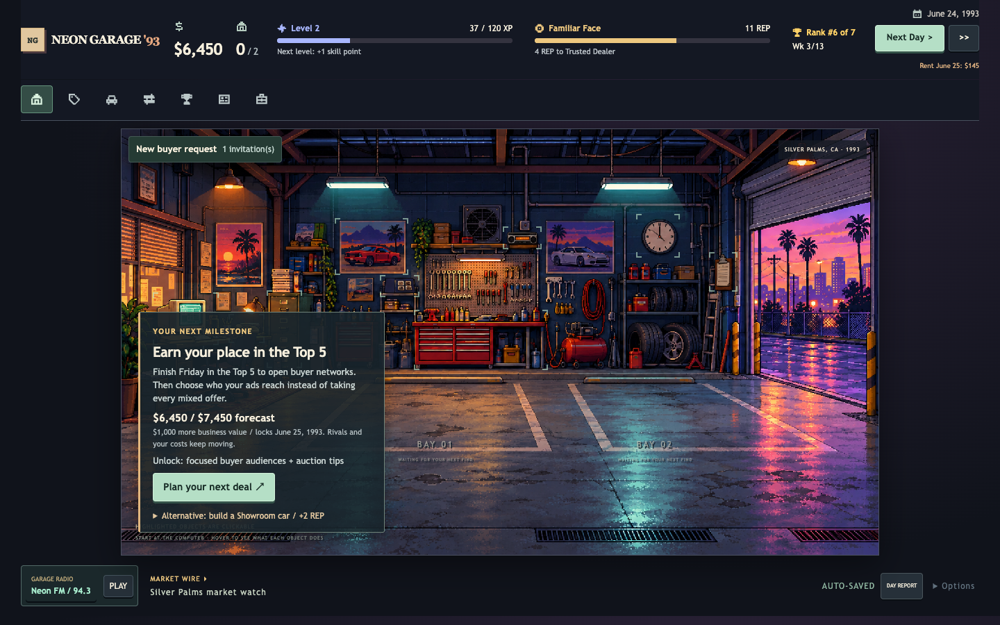

# Neon Garage '93

Pixel art autókereskedős tycoon, angol játékfelülettel. Jelenlegi verzió: v0.14.0 / Cut & Flow, a `main` ágon (2026. október 14-én beolvasztva a [codex/v0.14-cut-and-flow](https://github.com/Lovi78/neon-garage-93/tree/codex/v0.14-cut-and-flow) ágból). Előző: v0.13.0 / Run the Lot. Dokumentáció frissítve: 2026. október 14.

A `main` tartalmazza a korábbi fejlesztői ágakat is: `codex/v0.12-art-of-the-deal`, `codex/premium-retro-ux` (PR #1, merge `23b8a5f`), `codex/v0.13-run-the-lot` és `codex/v0.14-cut-and-flow`. Ezek az ágak történeti hivatkozásként maradnak meg.

A stabil main v0.14.0. Az új v0.14.2 fejlesztői változat a `codex/v0.14.2-purpose-and-fair-requests` ágon található. [Célok, megbízásvédelem, modellkarakter és ellenőrzés](neon-garage-93/PURPOSE-V0142.md).

A játék fájljai a [`neon-garage-93`](neon-garage-93/) mappában vannak. Indításhoz töltsd le a projektet, majd nyisd meg a mappában található `index.html` fájlt böngészőben. Nincs szükség telepítésre vagy szerverre.

- [Indítás, játékmenet és tesztelés](neon-garage-93/README.md)
- [2026. októberi audit és a v0.14 iránya](neon-garage-93/AUDIT-2026-10.md)
- [v0.13 vállalkozásvezetés és balanszmérés](neon-garage-93/MANAGEMENT-V013.md)
- [Jelenlegi felület, ikonok, audit és tesztek](neon-garage-93/UX-REDESIGN.md)
- [Korábbi v0.12.3 UX-kör](neon-garage-93/UX-V0123.md)
- [v0.12 audit, mechanikák és három gyakorlóhelyzet](neon-garage-93/TRADING-V012.md)
- [60 modelles katalógus](neon-garage-93/MODEL-CATALOG.md)
- [Aktuális fejlesztési roadmap](neon-garage-93/ROADMAP.md)
- [Verzióelőzmények és eredeti tervek](neon-garage-93/DEVELOPMENT-HISTORY.md)
- [Grafikai fájlok és generáló promptok](neon-garage-93/assets/ART-DIRECTION.md)

