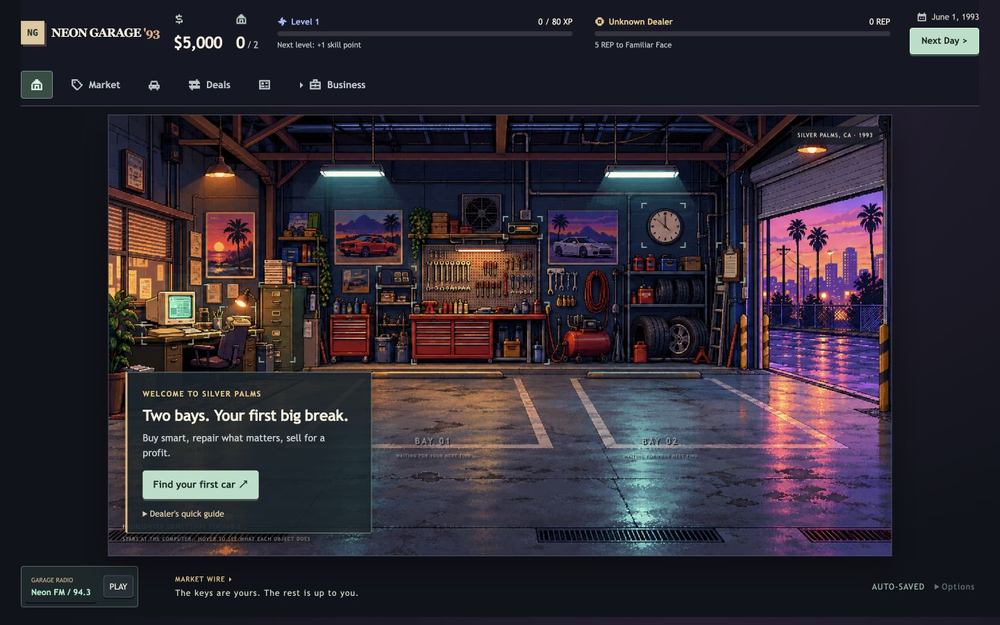

# Neon Garage '93

Pixel art autókereskedős tycoon, angol játékfelülettel. Jelenlegi verzió: v0.13.0 / Run the Lot. Dokumentáció frissítve: 2026. október 12.

A Premium Retro UX és az egységes pixelikonok a [PR #1](https://github.com/Lovi78/neon-garage-93/pull/1) révén bekerültek a `codex/v0.13-run-the-lot` fejlesztői ágba. Merge: `23b8a5f`, 2026. október 12. Az UX-forráság `codex/premium-retro-ux`; a legfrissebb játékot a v0.13-as célágból töltsd le. A verziószám 0.13.0 maradt, a felületi kör nem változtatott a játékszabályokon.

A v0.13 fejlesztései a [codex/v0.13-run-the-lot](https://github.com/Lovi78/neon-garage-93/tree/codex/v0.13-run-the-lot) ágon találhatók. A `main` külön, v0.11.0 állapotban marad a mainbe történő jóváhagyott beolvasztásig. A legfrissebb változat letöltéséhez a GitHub branchválasztójában ezt a fejlesztői ágat válaszd.

A játék fájljai a [`neon-garage-93`](neon-garage-93/) mappában vannak. Indításhoz töltsd le a projektet, majd nyisd meg a mappában található `index.html` fájlt böngészőben. Nincs szükség telepítésre vagy szerverre.

- [Indítás, játékmenet és tesztelés](neon-garage-93/README.md)
- [v0.13 vállalkozásvezetés és balanszmérés](neon-garage-93/MANAGEMENT-V013.md)
- [Jelenlegi felület, ikonok, audit és tesztek](neon-garage-93/UX-REDESIGN.md)
- [Korábbi v0.12.3 UX-kör](neon-garage-93/UX-V0123.md)
- [v0.12 audit, mechanikák és három gyakorlóhelyzet](neon-garage-93/TRADING-V012.md)
- [60 modelles katalógus](neon-garage-93/MODEL-CATALOG.md)
- [Aktuális fejlesztési roadmap](neon-garage-93/ROADMAP.md)
- [Verzióelőzmények és eredeti tervek](neon-garage-93/DEVELOPMENT-HISTORY.md)
- [Grafikai fájlok és generáló promptok](neon-garage-93/assets/ART-DIRECTION.md)

