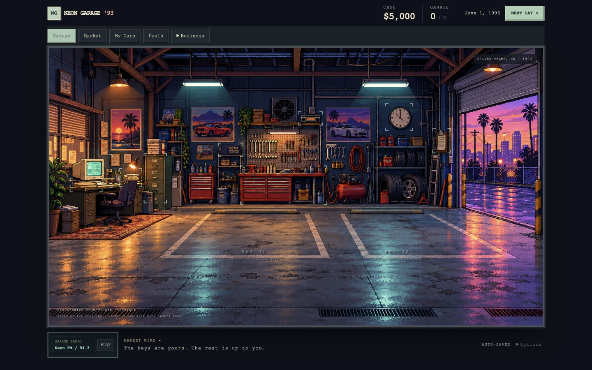
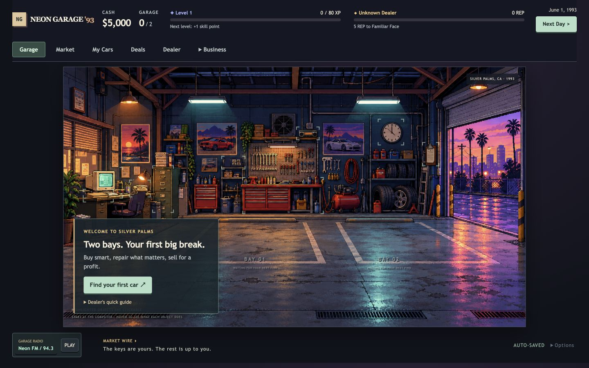
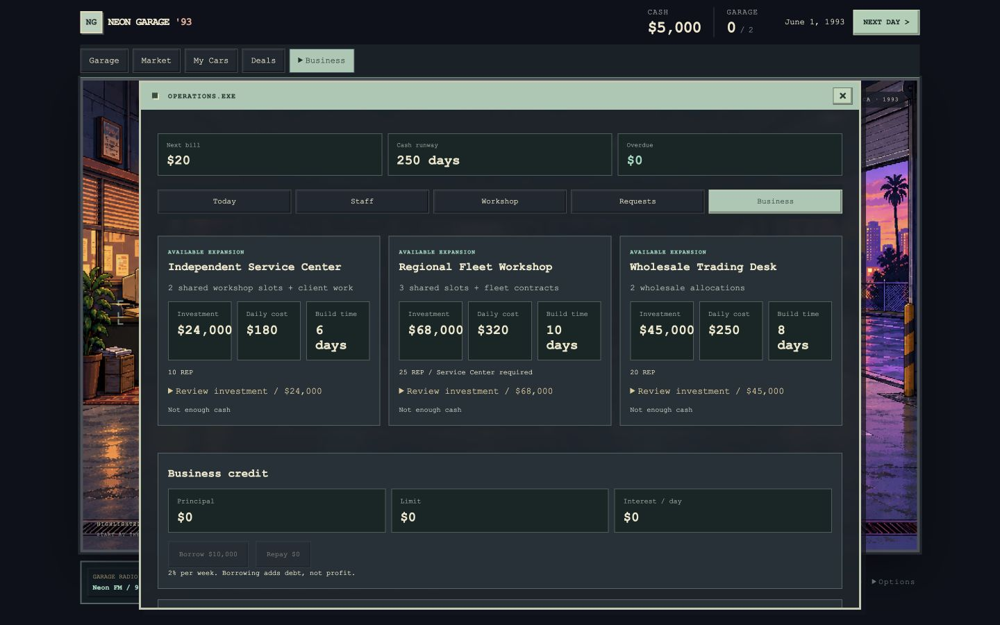
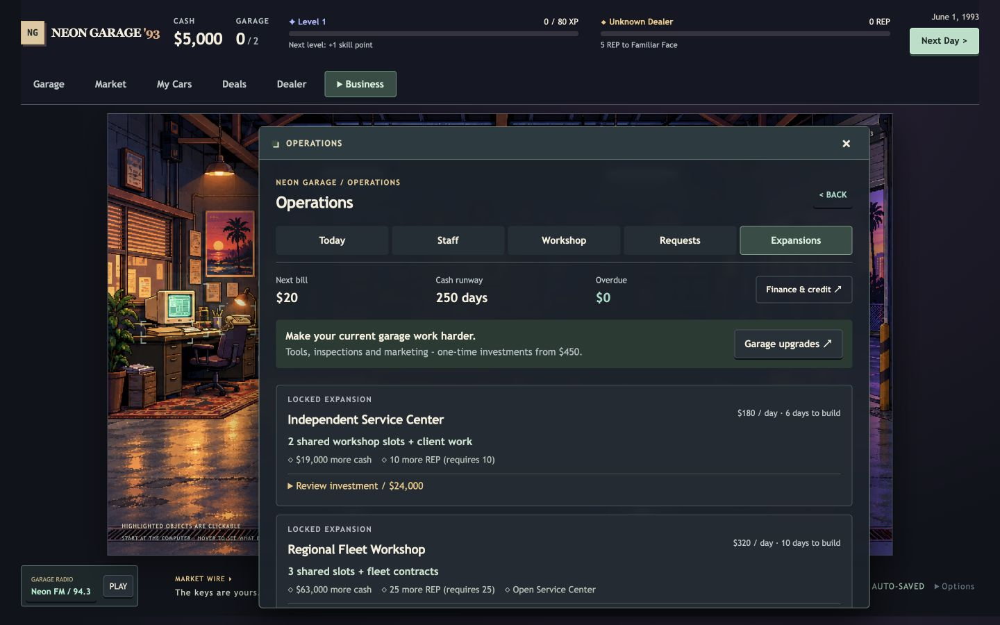
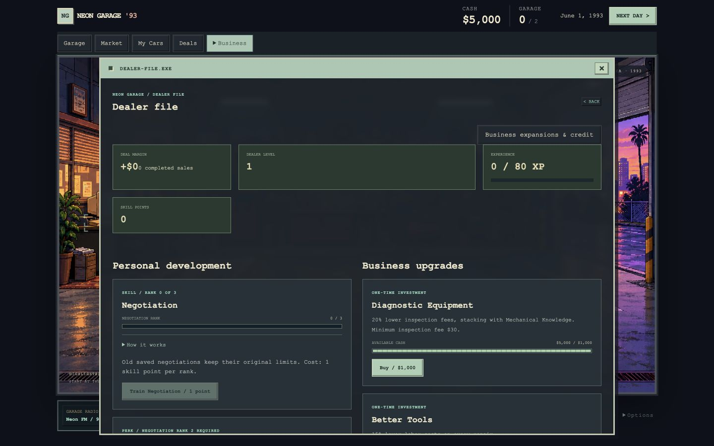
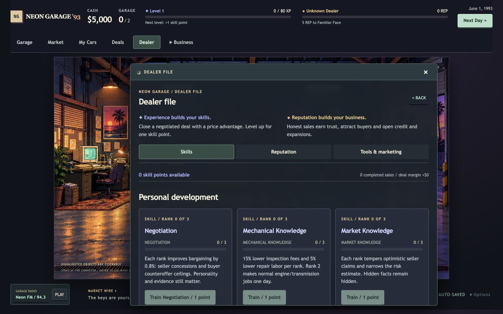

> Aktuális v0.14.2 célkártya, modellkarakter, biztosított megbízás és vevőközönség: [PURPOSE-V0142.md](PURPOSE-V0142.md).

> Aktuális v0.14.1 felület és ellenőrzés: [STABILITY-V0141.md](STABILITY-V0141.md). Az alábbi v0.13 képek és leírások történeti bizonyítékok; a jelenlegi kétoszlopos autólap, kompakt ranglista és ismételt navigáció nélküli ablak friss képei az új jelentésben vannak.

# Premium Retro UX - audit, megvalósítás és ellenőrzés

2026. október 12. A feladatban kért v0.12 UI/UX-csomag a ténylegesen elérhető v0.13.0 / Run the Lot játékra készült. Alap: `fe84539`, `codex/v0.13-run-the-lot`. Forráság: `codex/premium-retro-ux`. A [PR #1](https://github.com/Lovi78/neon-garage-93/pull/1) 2026. október 12-én beolvadt a `codex/v0.13-run-the-lot` ágba, merge-commit: `23b8a5f`; utolsó ikonos forráscommit: `5963790`. A jelenlegi játékot a v0.13-as célágból kell letölteni. A main külön v0.11.0 állapot, éles publikálás nem történt.

## Audit - módosítás előtt

Átnézett források: README, ROADMAP, HTML, ui.js, styles.css, pixel.css, progression, operations/strategy, enterprise, management és kapcsolódó tesztek. A böngészős audit a tényleges helyi állapotról készült, beleértve a már meglévő, még nem commitolt Garage-first munkát. A csatolmány szöveges feladat volt; külön referencia-képfájl nem érkezett.

- A HUD csak készpénzt, férőhelyet és dátumot mutatott. XP és REP csak a hosszú Dealer File végén volt követhető.
- A menüablak kis képernyőn ráfedett a HUD-ra, a fő navigáció pedig az ablak címe és tartalma közé került.
- A Dealer File egyszerre mutatott három skillágat, perkeket, pénzes fejlesztéseket és reputációt. A lényeghez hosszú görgetés kellett.
- A zárolt beruházások is AVAILABLE EXPANSION címkét kaptak. Csak az első akadály látszott; a hiányzó készpénz eltakarta a REP- és függőségi feltételeket.
- Üres garázsból nem vezetett hangsúlyos vásárlási gomb a piachoz. Az Operations inkább kapacitásadatokat és üres állapotokat ajánlott.
- A Business alatt további fülekhez kellett navigálni. A hitel a beruházások közé keveredett, a kis garázsfejlesztések külön hosszú listában éltek.
- Sok leírás és állapot 8-11 pixeles monospace szöveg volt. Az autós döntési sáv már létezett, ezt érdemes volt megtartani.
- A styles.css első sora egy csonka import maradványa volt. A javítás eltávolítja a hibás sort; nincs külső fontfüggőség.

Auditált fő nézetek: Garage, Market, My Cars, Deals, Dealer File, Operations/Today és Expansions, Finance, Customers, Collection; továbbá vásárlási adatlap és annak Overview/Inspection/Negotiation/Deal fülei. Az implementáció utáni kör a műhelyt, megbízásokat, értékesítést és napzárást is működés közben ellenőrizte.

## Redesign-koncepció

A garázs a világ, a menü a játékos eszköze. Visszafogott menta elsődleges műveletek, lila XP, arany REP; olvasható rendszerbetűk, retro márkafelirat, megtartott pixel art. A döntéshez szükséges ár, költség, feltétel és határidő látszik, a részletes működés külön nyitható.

## Megvalósítás

- Közös HUD: Cash, Garage, dátum, Dealer Level, XP, skillpont és következő REP-rang. A HUD és a fő navigáció görgetéskor is a képernyőn marad. Az autó-, model guide-, napzáró- és jelentésablak saját közös státuszfejlécet kap.
- Hat fő belépő: Garage, Market, My Cars, Deals, Dealer, Business. A Business közvetlenül nyitja a Today, Staff, Workshop, Buyer requests, Finance, Customers, Expansions, Tools & marketing és Collection nézeteket. A fő funkciók egy vagy két navigációs kattintással elérhetők.
- Dealer: Skills / Reputation / Tools & marketing. A három skillág együtt összehasonlítható, a perkek saját lenyíló részt kapnak. Rövid magyarázat különíti el a személyes tapasztalatot az üzleti bizalomtól.
- Operations: aktuális határidők és fizetési döntések elöl; napi idő és csapatkapacitás külön lenyitható. Üres készlet esetén a következő ajánlott lépés a Market.
- Expansions: meglévő és ténylegesen megépíthető üzletágak elöl, zárolt projektek rövidebb kártyán. Minden hiányzó feltétel látszik. A működési előny, napi díj, építési idő, tőkebefektetés, cash utána és a felszámolás feltételei döntés előtt elérhetők. A zárolt wholesale felület lenyitható.
- Finance: a hitel egyetlen otthona. Fent készpénzhelyzet és hitel, a 7 napos eredmény/bér és részletes történet külön nyitható. A meglévő részletes pénzügyi adatok megmaradtak.
- Üres garázs: rövid cél, Find your first car gomb és opcionális gyorssegítség. Saját eladható autó esetén az adott autóhoz vezető CTA; sürgős teendő mellett nincs versengő segítségkártya.
- Visszajelzések: valódi állapotváltozásból származó XP, szintlépés, új skillpont, REP-veszteség/nyereség, rang, megnyílt üzletág, elkészült javítás és új ajánlat. A felület nem oszt jutalmat. A rutin autóműveletek visszajelzése a döntési sávban jelenik meg, így nem takarja el a gombokat.
- Nagyobb betűk, egységes gombok, panelek, állapotok és görgetés. Az animációk rövidek, a reduced-motion beállítást tiszteletben tartják. Fülekhez nyilak/Home/End, lenyíló menükhöz Escape; művelet után a billentyűzetes fókusz megmarad.

Az eredeti játékszabályokat tartalmazó JS-modulokból csak az ui.js változott. A mentési kulcs, séma, automatikus mentés, pénz-, XP-, REP-, ár-, kamat- és jutalomképletek változatlanok. Új gameplay nincs. Framework és új futásidejű függőség nincs. A játék angol maradt.

## Ellenőrzés

Az automatizált ellenőrzés eredménye külön naplóban van:

- [128 szabályteszt](reports/ux-rules-output.txt): gazdaság, progression, finance/catalog, collection, customers, day report, strategy, ambience, opportunities, enterprise, trading, management.
- [30 felületi tesztblokk](reports/ux-ui-output.txt), ebből 8 új Premium UX integráció. A pénzes és skillműveletek eredményét az eredeti engine ugyanazon állapoton számított eredményével összevetjük. A navigáció nem ír új UI-adatokat a mentésbe.
- [Szimulációk](reports/ux-simulation-output.txt): 25 x 200 kereskedési nap és 30 x 180 management nap, összesen 10 400 szimulált nap. Véges pénz, jogosult dolgozói idő, mentés-visszaolvasás. Ez nem emberi játékélmény-teszt.
- `node --check js/ui.js`, `git diff --check`. A motorfájlok változatlanságát az alapcommithoz képest ellenőriztük.

Valódi böngésző: Codex In-app Browser / Chromium. Méretek: 1440 x 900, 1280 x 720, 390 x 844. Az ellenőrzés kizárólag külön helyi tesztmentéseket használt, a játékos meglévő böngészős mentése nélkül.

| Folyamat | Eredmény és bizonyíték |
| --- | --- |
| Új játék | $5,000, 0/2 autó, 1. szint, 0/80 XP, 0 REP; vásárlási CTA és két eltérő fejlődési sáv |
| Vásárlás és alku | Practice A: $2,200-ról $1,700 megállapodás, $90 vizsgálat, $50 átírás; vétel után $3,160 és +25 XP |
| Javítás | Detailing $76, következő nap elkészült; napváltáskor további $25 számla, $3,059 cash |
| Hirdetés | Inspected / disclose observed faults, $2,200 hirdetési ár; élő hirdetés és a kétórás előkészítés visszaigazolása |
| Eladás és level up | Elkülönített késői fixture: $5,500 eladás, +25 XP, 1 -> 2 szint, 15/120 maradék XP, +1 skillpont, 14 -> 17 REP és Trusted Dealer |
| Skill | Negotiation rank 0 -> 1; 3 -> 2 skillpont |
| Kis business upgrade | Better Tools megvétele, -$600, installed állapot |
| Zárolt beruházás | Friss játékban cash-, REP- és Service Center-függőség együtt; tiltott befektetés |
| Feloldott üzletág | Service Center -$24,000; hat napváltás után szeptember 15-én Open, $180 napi működés, közös műhelykapacitás és új ügyfélmunka |
| Vevői megbízás | European daily driver vállalása; szeptember 14-i határidő; megfelelő Golf átadása $5,650-ért, +3 REP, XP változatlan |
| Hitel | $10,000 felvétel és törlesztés, $29 -> $0 napi kamat; cash helyesen változott |
| Napváltás | Megerősítés, kihagyható jelenet, jelentés, javítás és üzletág megnyitása; állapot frissült |
| Visszatöltés | Practice A visszatöltéskor ugyanaz a készpénz, autó, XP és olvasatlan napi jelentés |
| Régi mentés | Régi schema fixture: $5,000, 3. szint, 85/160 XP, 1 skillpont; korábbi $2,500-as alku folytatva $2,400-on, készpénz és XP változatlan |
| Kis/nagy nézet | Három megadott méret vizuális ellenőrzése; 390 pixelen a dokumentum szélessége is 390, nincs vízszintes túlcsordulás; HUD top = 0 görgetés közben |
| REP-veszteség | Automatizált integrációban panasz elutasítása 15 -> 13 REP és -2 REP értesítés; külön kézi böngészős elutasítás nem történt |

A fixture oldalak a `tests/browser-fixtures` mappában vannak; újratöltéskor csak a külön QA-mentésüket állítják vissza. Nem valódi régi felhasználói mentésből származnak. Újragenerálás: `node tests/build-ux-fixtures.cjs`.

## Előtte / utána

Azonos 1440 x 900 képernyő és friss kezdőállapot. Az előtte-képek a munkakezdéskor meglévő helyi felületet mutatják, nem a régi main branch v0.11 felületét.

[Összehasonlító galéria](reports/ux-gallery.html)

| Nézet | Előtte | Utána |
| --- | --- | --- |
| Garage |  |  |
| Business / Expansions |  |  |
| Dealer |  |  |

További bizonyíték: [szintlépés](reports/ux-level-up.jpg), [mobil hirdetés](reports/ux-selling-390.jpg), [régi mentés](reports/ux-legacy-save-1280.jpg), [mobil Garage](reports/ux-after-garage-390.jpg), [mobil Business](reports/ux-after-business-390.jpg), [mobil Dealer](reports/ux-after-dealer-390.jpg).

## Megmaradó korlátok

- A hosszú ügyfél-, pénzügyi és munkalisták továbbra is görgetést igényelnek. Ez különösen kis képernyőn érezhető; a döntési információk és fő navigáció nem vesznek el.
- Valódi régi játékosi mentés nem volt csatolva. A kompatibilitás régi sémát követő fixture-rel és meglévő migrációs tesztekkel ellenőrzött.
- Safari/Firefox és fizikai telefon nem lett kézzel tesztelve. A 390 pixeles próba asztali Chromium emulált mérete.
- Nincs új hosszú emberi balanszteszt vagy rádió-meghallgatás ebben a körben. A hangulatassetek és gazdasági szabályok változatlanok; a szimuláció ezt nem helyettesíti.
- A PR #1 a v0.13-as fejlesztői ágba már beolvadt. A mainbe történő merge és éles publikálás külön, még nem elvégzett lépés.

A munkakezdéskor meglévő helyi módosításokat külön baseline commit őrzi. Az eredeti munkamappa diffje az audit előtt elmentett diff-fel bájtra egyezik; ez az ág nem írta felül azt a munkát.

## Jóváhagyott ikonos kiegészítés

A HUD Cash és Garage capacity feliratait pixelikon váltja; a dátum naptárikont, az XP csillagot, a REP arany jelvényt kap. A pluszos skillpont-jelvény csak elkölthető pont esetén jelenik meg. A számok, rang és mértékegységek megmaradnak. Desktopon Garage / My Cars / Dealer ikonos gomb, fókuszra és rámutatásra funkciónévvel; Market / Deals / Business ikon és szöveg. Mobilon minden név látható. Dekoratív, helyben rajzolt SVG-k, akadálymentes gombnevek, külső asset és függőség nélkül.

A [30 UI-tesztblokk újra sikeres](reports/ux-icons-ui-output.txt). Valódi Chromium-próba: 1440 x 900 és 390 x 844, billentyűzetes tooltip és Dealer-belépés. Mobilon dokumentumszélesség = 390 px, nincs vízszintes túlcsordulás. [Desktop](reports/ux-icons-1440.jpg), [tooltip](reports/ux-icons-tooltip.jpg), [mobil](reports/ux-icons-390.jpg). A fenti előtte/utána összehasonlítás az ikonok előtti redesign-kör felvétele.

A jóváhagyott kiegészítés és a teljes redesign a [PR #1](https://github.com/Lovi78/neon-garage-93/pull/1) merge-ével bekerült a `codex/v0.13-run-the-lot` ágba (`23b8a5f`). A main ettől külön marad. A merge és a branch-állapot élő GitHub-visszaolvasással ellenőrzött.
